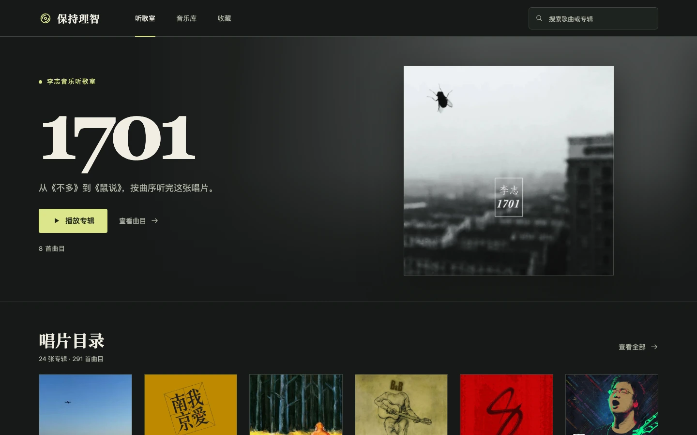
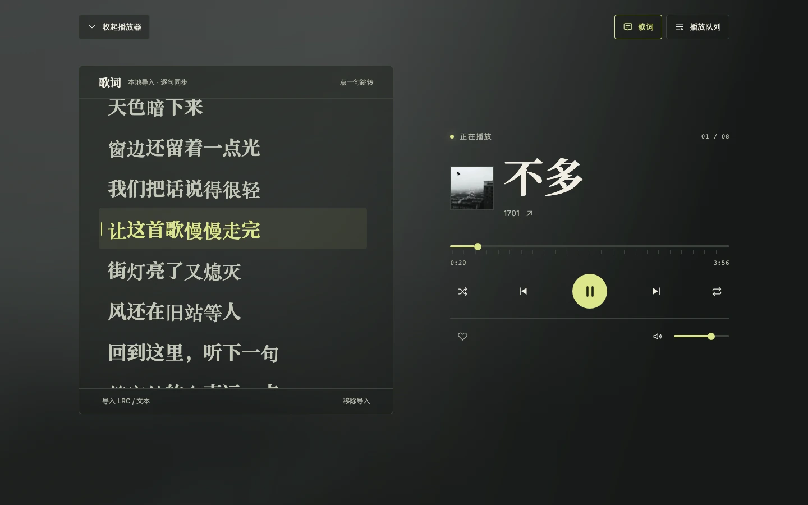
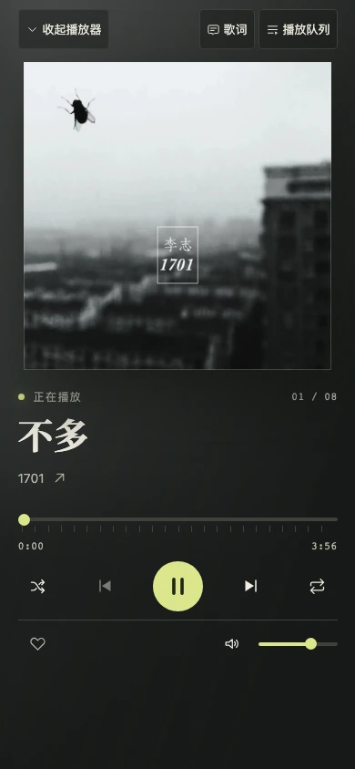

# 保持理智

一间李志音乐的个人听歌室。唱片架收录 23 张专辑，曲库保留 291 个录音版本。支持黑胶播放器、同曲异版切换和逐句歌词。

[进入听歌室](https://baochilizhi.com/)

[](docs/preview/listening-room.webp)

| 桌面歌词 | 手机播放器 |
| :---: | :---: |
| [](docs/preview/synced-lyrics.webp) | [](docs/preview/mobile-player.webp) |

<sub>以上为实际运行截图。</sub>

## 本地运行

使用 Node.js 20.19+ 或 22.12+。

```sh
npm ci
npm run dev
```

用浏览器打开终端显示的地址。播放时点击「歌词」可查看同步歌词，也可导入自己的 LRC 或文本。

构建用 `npm run build`。测试前运行 `npx playwright install chromium webkit`，再运行 `npm test`。

## 内容来源

非官方个人项目。音源和封面来自 [nj-lizhi/song](https://github.com/nj-lizhi/song)，歌词按录音版本从 [LRCLIB](https://lrclib.net/) 在线读取。
